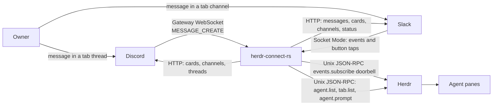

# herdr-connect-rs

Two-way Rust bridge between Discord or Slack and agents in local Herdr panes, through a shared chat interface.

The Slack adapter uses `slack-morphism` with `SLACK_BOT_TOKEN`, `SLACK_APP_TOKEN`, and `SLACK_OWNER_ID`; the team ID comes from `auth.test`. Each mirrored Herdr tab has one public Slack channel named `<workspace label>-<workspace id>-<tab label>-<short tab id>` in lowercase Slack channel-name format, retaining Unicode letters and numbers. The short tab id follows the colon. Labels are shortened to fit 80 characters; IDs are preserved. The topic stores `herdr workspace [workspace_id] tab [full_tab_id]`. The owner is invited when the channel is created. There are no workspace channels or bot thread-parent messages.

Owner messages, agent replies, activity, permission cards, and question cards use the tab channel. Terminal prompts use the owner's display name and avatar, fetched once at startup through `users.info`; profile lookup failure stops startup. Prompt-submission and free-text-answer acknowledgements are ephemeral messages to the owner. Working status uses `assistant.threads.setStatus` on the latest accepted owner message; it is visible in the channel view. It remains set while any pane in the tab works. Status errors are logged without failing accepted prompts or successful posts.

Socket Mode uses one connection. Only owner messages and button taps are accepted. An archive event naming the owner closes its Herdr tab, not the workspace. Other actors and deletion events without owner proof close nothing. Closing a Herdr tab renames and archives its channel to release the original name. Workspace and tab renames reconcile channel names; startup also reconciles names and removes obsolete topology. Renames and channel closure run in background tasks; rate limits do not block message delivery.

The `slack` subcommand runs the shared bridge loop with the same `testrun-` exclusion as the no-argument Discord run. The service uses Discord only. Permission cards have Allow and Deny buttons; question cards show headers and option descriptions. Single-choice questions have buttons; multiple-choice questions have a menu followed by Submit choices. Empty submissions receive an ephemeral refusal and keep the card open. When a question card is retired after the pane leaves blocked, Slack preserves the question text and removes its buttons with a Resolved label. Tests run serially in the configured Slack test workspace and count only unarchived `testrun-` channels in their zero-leftover check.

The ignored owner acceptance driver prints each `OWNER ACTION:` and waits up to 20 minutes: message, terminal prompt owner profile and visible working status, working status cleared after settling, Deny, Allow, single choice, multiple choice, free text, then channel archive. Permission cards expire after 45 seconds; the working task runs an allowed three-minute Python wait. The driver owns a `testrun-` workspace with Claude, an isolated broker, and one Socket Mode connection, and cleans up its resources. Take production snapshots separately before and after.

```bash
set -a; . ./.env >/dev/null 2>&1; set +a
cargo test tests::slack_owner::owner_acceptance_runs_in_order -- --ignored --exact --nocapture --test-threads=1
```

## Architecture

Each bridge process connects Herdr to Discord or Slack through the shared chat interface. Discord events arrive over its Gateway WebSocket; Slack events and button taps arrive over Socket Mode. Both adapters use their service's HTTP API for delivery and Herdr's Unix socket for agent operations.



### Discord adapter

The following topology and delivery rules describe Discord. Slack uses the tab channels described above; both adapters share the session watchers and agent interaction logic.

- **Herdr → Discord:** at startup, the bridge lists agents and tabs and syncs eligible workspace channels and tab threads in a task beside the event loop. It then deletes obsolete topology within its scope: production preserves `testrun-` resources, and test bridges preserve production resources. A Herdr subscribe event wakes the bridge to list agents and tabs and diff snapshots. The mirror is four rules, one watcher per pane:

  1. **A session-carrying pane appears:** create its tab thread and open one watcher on its vendor log at the current end -- or at position 0 if the log does not exist on disk yet, so the whole log it later writes is posted. A Codex pane reports its session only when its first prompt is submitted, so a session whose log was created after the bridge first saw the pane without one is also followed from position 0, and the first prompt and its reply are mirrored. For a Codex session with several rollout files, follow the file with the newest filename timestamp; continuation files belong to the same session, and older files are not merged. A pane whose Herdr integration reports no session identity is not mirrored: no tab thread and no card of any kind, until a later snapshot reports one (its workspace channel is per workspace and may still exist because another pane in it has a session). A session-carrying tab whose label is still Herdr's auto-assigned number is renamed, through the bounded `tab.rename` socket request, to a readable `word-word-word` name derived from its tab id, and its thread is named from that label like any owner-given label; owner-given labels are never touched, and a tab already carrying a generated name is not renamed again. The bridge does not follow `tab.renamed`: thread names are frozen once created. A tab whose rename fails keeps its numeric label, is not mirrored, and is retried on every pass; its error is logged once per tab until a rename succeeds. The first snapshot after start is silent.
  2. **The log gains a complete assistant text:** post it as its own plain message (never a tool call), in log order. This is per log position, and status plays no part -- a text written while the pane is `working`, `done`, or `idle` is posted the same way. A bridge restart re-follows from the current end, so it reposts nothing; separately, each message's nonce is derived from its log position, so if the same position were ever posted twice within Discord's nonce window it would be suppressed as an exact repeat. Content comes from the vendor session Herdr reported, not from scraping the pane.
  3. **The pane goes `blocked`:** post the blocked, permission, or question card. `working` and `done` post nothing -- a settled turn's reply, and a failed turn's error, both reach Discord as the pane's own live text under rule 2, not as a turn-end card. On the initial transition to a Claude question dialog containing the `Type something` option, the bridge polls detection and the vendor log for up to three seconds before building its card. Later checks of that dialog read each once without waiting. Permission and other dialogs skip the question wait.
  4. **The pane closes, or its session resolves to a different log:** close the watcher. A closed Herdr tab deletes its Discord thread; a closed Herdr workspace deletes its Discord channel (Discord removes its threads with it). Whenever the bridge deletes a tab thread, or the audit log shows that the owner deleted one, the "started a thread" system message Discord posted for it in the workspace channel is deleted too, which carries the thread's own id. Deletion is two-way: when the owner deletes a tab thread in Discord, the bridge runs `herdr tab close` for the tab named in the thread's `[tab_id]` suffix, and when the owner deletes a workspace channel it runs `herdr workspace close` for the workspace mapped to that channel by the bridge's channel registry. The bridge closes something only when the guild audit log has a `THREAD_DELETE` or `CHANNEL_DELETE` entry for that thread or channel whose user is `DISCORD_OWNER_ID`. A deletion by anyone else, including the bot's own token, a deletion with no matching entry, and a failed audit-log request close nothing; a failed request is logged. Reading the audit log needs the bot's View Audit Log permission; without it the request fails with HTTP 403, so a deletion of a bridge thread or workspace channel logs that error and closes nothing. The tab is resolved from a durable registry of bridge-owned thread ids that cache invalidation and refetches never clear (filled from in-scope fetches, creates, and archived listings), so a thread that auto-archived or left the cache is still resolved; a deleted thread the registry does not hold is not a live tab's thread and is ignored, with no Herdr call and no notice. Each in-scope workspace channel's archived threads are registered at startup in a task independent of the Herdr snapshot and the delete pass, so the thread of a sessionless tab that auto-archived is still resolved; a listing that fails is logged as an error. The close goes through Herdr's bounded RPC socket while holding the topology cache lock, so a delivery or sync that takes the lock afterwards finds the tab gone; a delivery that raced ahead of the gateway event can create one replacement thread first, and the close then ends the tab and the bridge's tab-closed handling deletes that replacement. When the bridge deletes a thread or channel itself, it drops that id from the registry. That is the only time a watcher closes.
- **Terminal prompts → Discord:** the owner's display name and avatar are fetched once at startup from `GET /users/{DISCORD_OWNER_ID}`. For every session-carrying pane with a resolved tab thread, following its vendor log for new user prompts starts the moment the bridge first sees the pane, using the same `notify` watch that drives live text: each new prompt is posted once into the tab thread, in log order, before any assistant text it produced, through a bridge-owned webhook (`herdr-connect owner`, one per workspace channel, found by name or created) executed with the owner's identity and `thread_id`. A prompt already in the log at that first sight is never replayed. A prompt the bridge itself just submitted from Discord is recognized once and dropped rather than mirrored back into the thread it came from. No thread or no session: dropped silently; a delivery error against an unknown channel or unknown webhook clears the cached route or webhook and logs, and the next mirrored prompt resolves both again through the cache-first path -- there is no in-call retry.
- **Discord → Herdr:** gateway events. An owner message in a thread named `… [tab_id]` under topic `herdr workspace [workspace_id]` becomes `agent.prompt` when exactly one matching pane is `idle`, `done`, or `working`; a `blocked` pane is refused because its dialog would receive the text, except a reply in the thread of an open question card, which is that question's free-text answer. The bridge keeps no queue: a prompt sent to a `working` pane is queued by the agent itself and answered after the current turn, and the bridge does not mirror it back when the agent starts it. Other surfaces stay silent.

For Discord, identity is the topic and the `[tab_id]` suffix. Existing Discord names are not renamed.

### Shared agent behavior

- **Permissions (optional):** `herdr-connect-rs hook` uses `HERDR_CLAUDE_BROKER_SOCKET`; install the matching [Claude](examples/claude-hooks.json), [Codex](examples/codex-hooks.json), or [Cursor](examples/cursor-hooks.json) hook configuration to enable Allow/Deny cards in either chat service.
- **Activity (optional):** `herdr-connect-rs activity --vendor claude`, `--vendor codex`, and `--vendor cursor` use the same broker socket and hook configurations. Each tool call updates one message per pane per turn in its Discord thread or Slack channel. The first call posts it, later calls edit it, and a new turn starts a new message. A frame is dropped if the tab has no chat route or the latest Herdr snapshot does not report a working pane with a session.
- **Questions (Claude only):** `AskUserQuestion` opens Claude's terminal dialog and blocks the pane. The owner can answer there or through either chat service; no hook or deadline applies. Cards mention the owner and use the pending vendor log plus the displayed dialog. Single-select questions have option buttons. Multiple-choice questions use a Discord select menu or a Slack menu followed by Submit choices. A message in the mapped thread or channel supplies a single-select free-text answer; multi-select free text is refused.

  Answers type the native dialog keys through Herdr: an option number for single select; option numbers, `right`, and a final `enter` for multiple choice; the free-text option number, text, and `enter` for free text. A multi-question call updates one card as each answer advances the dialog, with an extra `enter` to submit the final single-select or free-text answer on its review screen. Before typing, the bridge rechecks the dialog. A terminal answer retires the card or advances it to the next question; failed input asks the owner to answer in the terminal. When the pane leaves blocked, Discord shows `resolved: pane left blocked`; Slack retains the question with a Resolved label. Partially toggled terminal choices remain in place when a chat answer is typed.

The no-argument Discord bridge and the `slack` bridge exclude `testrun-` Herdr workspaces, tabs, chat channels, and Discord threads or threads under test channels. Their messages, buttons, and close events are ignored, and cleanup preserves their topology. Both adapters default to test-only scope: inbound messages, buttons, deletions, and archives require both a test chat resource and a `testrun-` Herdr workspace or tab. Production events receive no response; Discord test deletion registries contain only test topology. Test cleanup deletes every `testrun-` Discord channel and thread in the configured guild. Run tests serially with the Discord service up; allow only one Socket Mode connection to the Slack test app. The service stays Discord-only.

## Configuration

`.env` (mode `600`, gitignored) contains the credentials for the selected adapter:

- `DISCORD_TOKEN`
- `DISCORD_GUILD_ID`
- `DISCORD_OWNER_ID`
- `SLACK_BOT_TOKEN`
- `SLACK_APP_TOKEN`
- `SLACK_OWNER_ID`

Set `HERDR_SOCKET_PATH` if the Herdr socket is not the default. Slack discovers its team through `auth.test`. Its bot needs `users:read` and `chat:write.customize` to mirror prompts with the owner profile. Never print or commit `.env`. Keep one production bridge per chat destination. Both adapters default to test-only scope; the no-argument, `slack`, and `broker` entry points select service scope. Standalone `broker` keeps test-run exclusion disabled.

The no-argument command selects Discord. Use `cargo run -- slack` for Slack; keep that connection closed while tests use the same Slack app.

```bash
set -a; . ./.env >/dev/null 2>&1; set +a; cargo run
```

## Codex panes

Start Codex panes with `codex --no-daemon`. Without it, Codex runs one shared background server per `CODEX_HOME` that executes hooks with the environment of the pane that started it, so sessions and activity from every Codex pane are attributed to that one pane.

## Docs

- [AGENTS.md](AGENTS.md) — how to work in this repo
- [CONTEXT.md](CONTEXT.md) — terms
- [ROADMAP.md](ROADMAP.md) — remaining work
